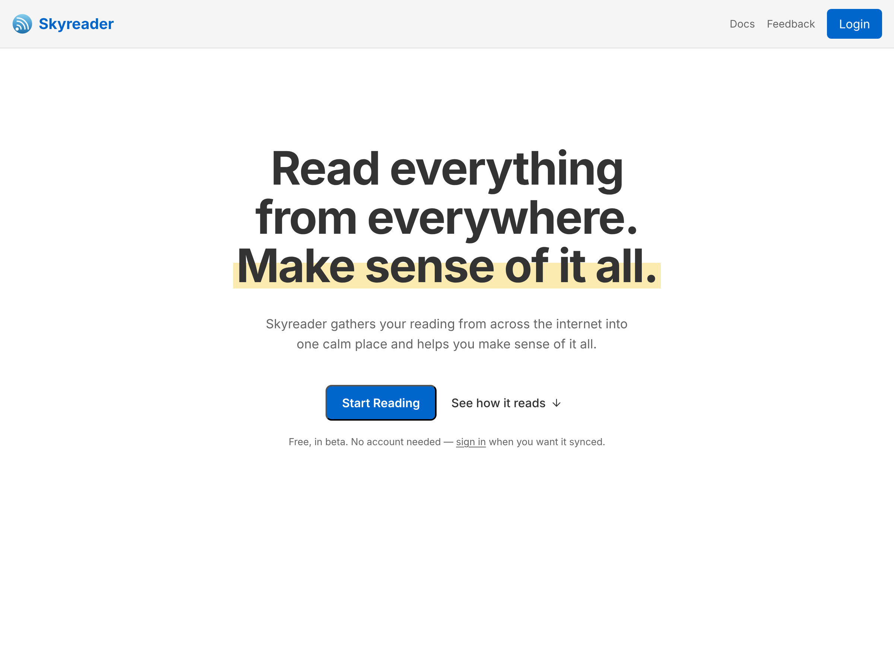

## Read first, sign in later

On [skyreader.app](https://skyreader.app), **Start Reading** opens a guest reader: a curated set of feeds you can read right away, no account needed. As a guest you can read, mark things read, save articles, highlight, and build a daily magazine. Everything stays on your device.

To add your own feeds, read on more than one device, or share to a linkblog, sign in. What you did as a guest comes with you.

## Signing in

**If you have a Bluesky account, sign in with your Bluesky handle** (like `you.bsky.social`). That's all most people need to know.

The longer answer: Skyreader uses your **Atmosphere account**, the login for the open network Skyreader and Bluesky both run on. Your account lives with a provider you choose, not locked inside one app. Bluesky is the most popular provider, but any provider works.

If you're new to the Atmosphere, the sign-in page has a sign-up path that creates an account with the provider of your choice.

There is no separate Skyreader password. Sign-in happens on your provider's page, and Skyreader never sees your credentials.

Sign-in asks only for the basics. When you first turn on a feature that writes to another Atmospheric app, such as backing your saves with Semble or Margin, Skyreader asks for that one permission. Your provider confirms it and you come straight back, still signed in.

## Your first few minutes

A new account starts nearly empty. Four things make it yours:

1. **Bring what you already follow.** Coming from another feed reader, export an OPML file there and choose **Import OPML** on the **+** button's **Website** tab. Otherwise, paste the address of a site you read into the same tab. [Adding sources](/guide/adding-sources/)
2. **Bring what you've saved.** Coming from Pocket, Instapaper, Readwise Reader, Omnivore or Matter, import your export file in **Settings → Library & privacy → Saved articles**. [Importing your library](/guide/importing-your-library/)
3. **Make saving one tap.** Install the browser extension, or add Skyreader to your phone's share sheet, so you can save what you find anywhere. [Save and subscribe from anywhere](/guide/adding-sources/#save-and-subscribe-from-anywhere)
4. **See what people you follow share.** On **Home**, **Allow access** brings in the links people you follow on Bluesky are sharing. [From your follows](/guide/from-your-follows/)

## Finding your way around

- **Home** is the front page: your reading, resumable where you left off. On a new account, it starts with the links people you follow are sharing, and ways to add your own sources.
- **Feeds** is everything you follow, with the sidebar of sources and channels.
- **Library** holds everything you've saved, from your feeds or from anywhere on the web. Read it two ways: the **Queue** is what to read next, and the **Shelf** is what you keep and come back to, like books and PDFs. See [Your Library](/guide/your-library/).
- **Daily** is your magazine, built from your saves. See [The daily magazine](/guide/reading/#the-daily-magazine).
- **Highlights** collects every passage you've highlighted, with a review deck. See [Saving and highlights](/guide/saving-and-highlights/#the-highlights-page).
- **Rooms** lists the reading rooms you've joined and ones people you follow are in. See [Reading rooms](/guide/reading-rooms/).
- **Linkblog** is where your shared links live. See [Sharing](/guide/sharing-and-your-linkblog/).
- **The bell** gathers what's new for you: @mentions in shared articles, news about feedback you've filed, and new posts on the [Skyreader Dev Log](https://skyreader-dev.leaflet.pub). Once you've seen something, it stays seen on all your devices.

## Installing the app

Skyreader is a web app you can install:

- **iPhone / iPad:** in Safari, Share, then **Add to Home Screen**.
- **Android:** in Chrome, menu, then **Add to Home screen** (or **Install app**). Once installed, Skyreader appears in the system share sheet, so you can save articles from any app.
- **Desktop:** Chrome and Edge show an install icon in the address bar.

Installed or not, Skyreader works offline: your feeds, saves, and highlights are stored locally, and anything you do offline syncs when you reconnect.
