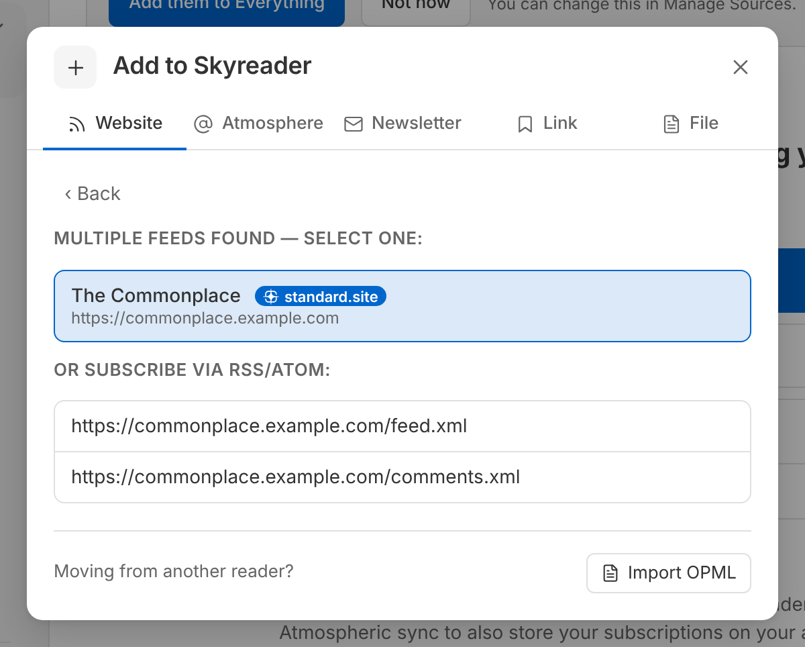

Skyreader reads three kinds of sources:

- **RSS and Atom feeds**: any blog, news site, or site that publishes a feed.
- **standard.site publications**: writing published on the Atmosphere, from apps like Leaflet.
- **Email newsletters** (Supporter): sent to a private address, read in Skyreader.

## Add a feed

The **+** button (or the **a** key) opens **Add to Skyreader**, with a tab for each kind of thing you can bring in: **Website**, **Atmosphere**, **Newsletter**, **Link** (an article to save), and **File** (a PDF or EPUB to upload). It reopens on the tab you used last.

On **Website**, paste any page URL, or just a domain; Skyreader finds the feeds on that page. One match subscribes you directly, several gives you a picker. When a site publishes both a standard.site publication and an RSS feed, the publication is listed first, since it usually carries the full text.

A paid or member-only feed (Patreon, Supercast, a link with a personal key in it) is meant for you alone. If you have Atmospheric sync on, which makes your feed list public, Skyreader asks before publishing a link like that and lets you keep that one feed private. An OPML import keeps such feeds private without asking. See [Private feeds](/your-data/#private-feeds).

## Follow a person

The **Atmosphere** tab follows an Atmosphere account (Bluesky, Blacksky, and others). Search by handle or name, pick the account, and Skyreader finds their standard.site publications for you to subscribe to.

## Email newsletters

Supporters get a private email address for newsletters. Find it on the **+** button's **Newsletter** tab (or in **Settings → Newsletters**), and use it when you sign up for a newsletter, or forward issues to it. Each sender becomes a source under **Manage Sources → Newsletters**, and each issue arrives as an article. A signup confirmation arrives the same way, so you can click its link right in the reader.

- **Keep the address to yourself.** Anything sent to it lands in your reader. If it leaks, **Get a new address** replaces it; newsletters you already have stay, and the old address stops working.
- **The email is the article.** Skyreader shows the issue as it arrived and never fetches a web copy, so there's no **Fetch full article** for a newsletter. Saving one keeps the email too, and the save stays private to Skyreader even when your saves are backed by Semble or Margin.
- **Newsletters stay private.** They aren't shared with anyone, and Atmospheric sync never publishes them.
- **Removing a newsletter** stops its mail reaching Skyreader, but it doesn't unsubscribe you with the sender. Blocked senders are listed in **Settings → Newsletters**, where you can let one back in.
- **If you leave the Supporter plan**, the address stops receiving mail. Newsletters you already have stay readable.

## Your Bluesky likes and bookmarks

Like or bookmark a post on Bluesky, and the article it links to can be waiting in your reader. Go to **Manage Sources**, find **Your Bluesky likes** or **Your Bluesky bookmarks** under **The Atmosphere**, and choose **Add**. Bookmarks are private on Bluesky, so the first time Skyreader asks for permission to read them: choose **Allow** and confirm on your account provider's page.

- **Only posts with a link.** A post that links somewhere becomes an article: its card shows the post's words, then the card for the page it links to. Open either to read the page. Posts without a link are left out, and so are links back to Bluesky.
- **Newest first, by when you liked or bookmarked it.** New ones arrive within a few minutes while you read.
- **Read it, save it.** Open one to read the full article. Save it like any other article.
- **Un-liking leaves it here.** Remove the article by marking it read, or remove the source to clear them all.
- **They stay private.** Skyreader never posts anything with them, and Atmospheric sync never publishes them.
- **They count toward your plan's active sources.** At the limit, a new one is added parked and gathers nothing until you make room.

## Import and export

**Import OPML** on the **+** button's **Website** tab (also in **Settings → Library & privacy → Import Feeds**) takes an OPML file, or a plain text file with one feed URL per line. You pick which feeds to bring in. Folders from your old reader come across as Skyreader folders.

Feeds you already follow are skipped. If some of them have no folder yet, the import offers to put them into the file's folders, so importing the same file again fills in folders that didn't come across the first time. It never moves a feed out of a folder you chose.

**Export OPML** hands your whole subscription list back at any time, folders included. Your feeds are never locked in.

## Save and subscribe from anywhere

You don't have to be in Skyreader to add to it:

- **Browser extension** ([Chrome](https://chromewebstore.google.com/detail/skyreader/kdefpnnpmajcclfepekgdkcdiklfooed) or [Firefox](https://addons.mozilla.org/firefox/addon/skyreader/)): a toolbar button that saves the page you're reading and lists the feeds it publishes, each with a subscribe button.
- **Bookmarklets** (desktop): drag **Save to Skyreader** and **Subscribe in Skyreader** from **Settings → Save from anywhere** to your bookmarks bar.
- **iPhone / iPad:** add the Save and Subscribe shortcuts from the same settings section; they appear in the share sheet.
- **Android:** install Skyreader to your home screen and it appears in the system share sheet.

## Discover

The **Discover** page suggests the writing of the people you follow on Bluesky, on two tabs: their publications, and their Skyreader linkblogs. Publications covers their standard.site publications and the blogs and newsletters Skyreader finds at their sites: the site at a domain handle (someone.com), the links on their Bluesky profile and their [Sifa](https://sifa.id) profile, and sites mentioned in their bio, like a Substack or Ghost blog. Each has a one-tap subscribe. One search covers both tabs, and each tab shows how many match. To stop seeing an account's suggestions, choose **Hide account** on its row.

**Manage Sources** shows a few of these suggestions under **Find more**, after your own sources, and so does Home while your library is still empty.

## Channels

Channels group your library into views: by topic, by kind of source, or by any filter you like. Skyreader suggests some (a Newsletters channel for your newsletter-ish feeds, for example) and you can create your own. See [Reading](/guide/reading/).

## Limits

The free plan includes 100 active feeds. Supporters get 1,000. See [Supporter](/supporter/).
