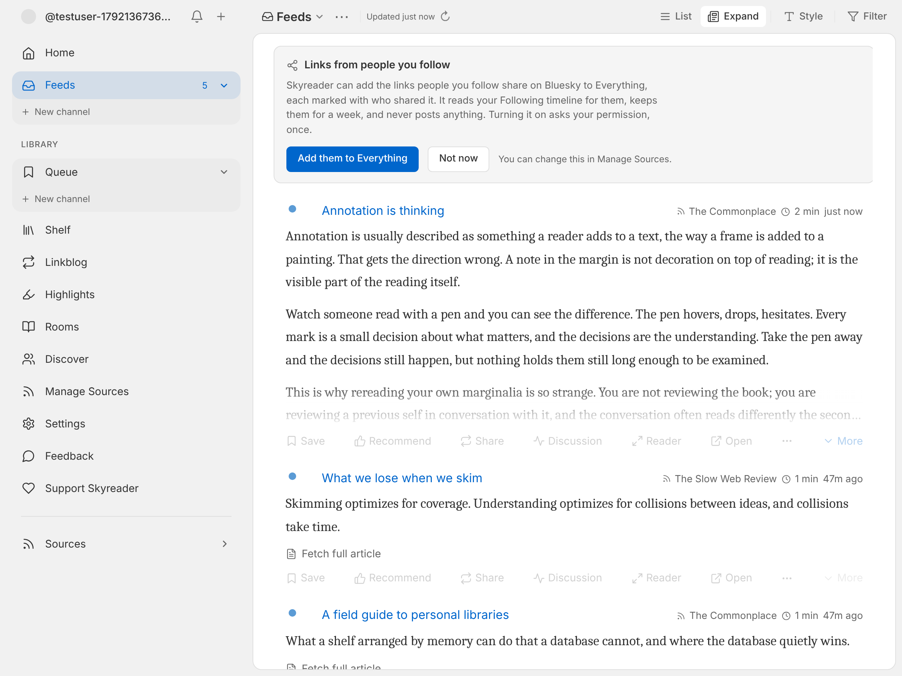
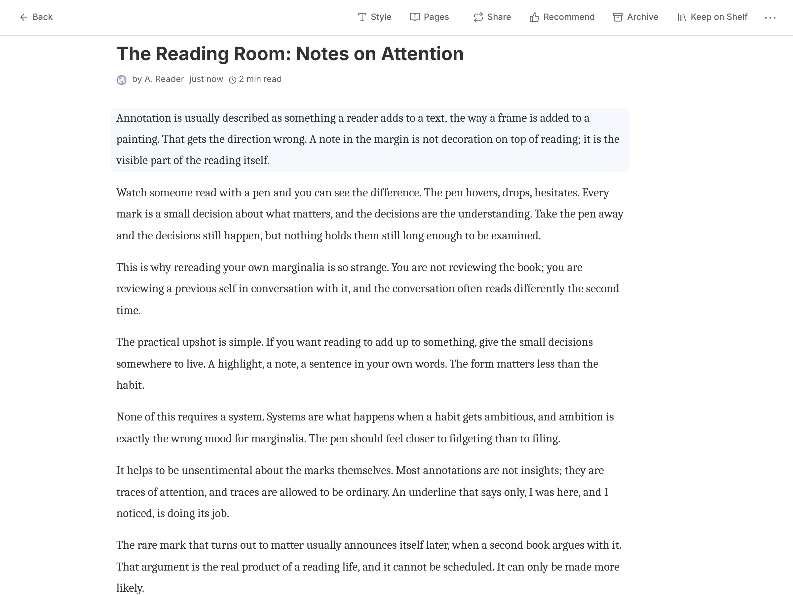
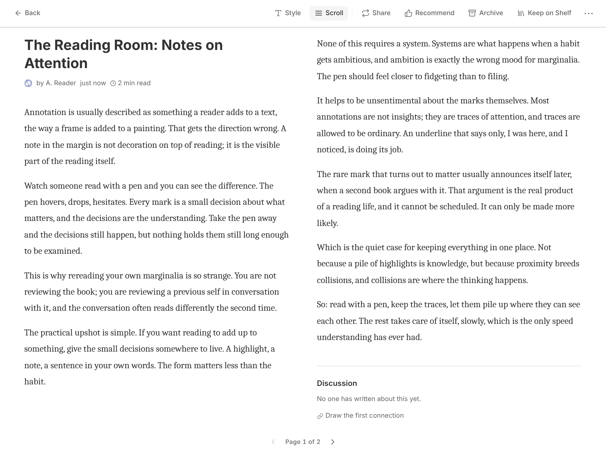
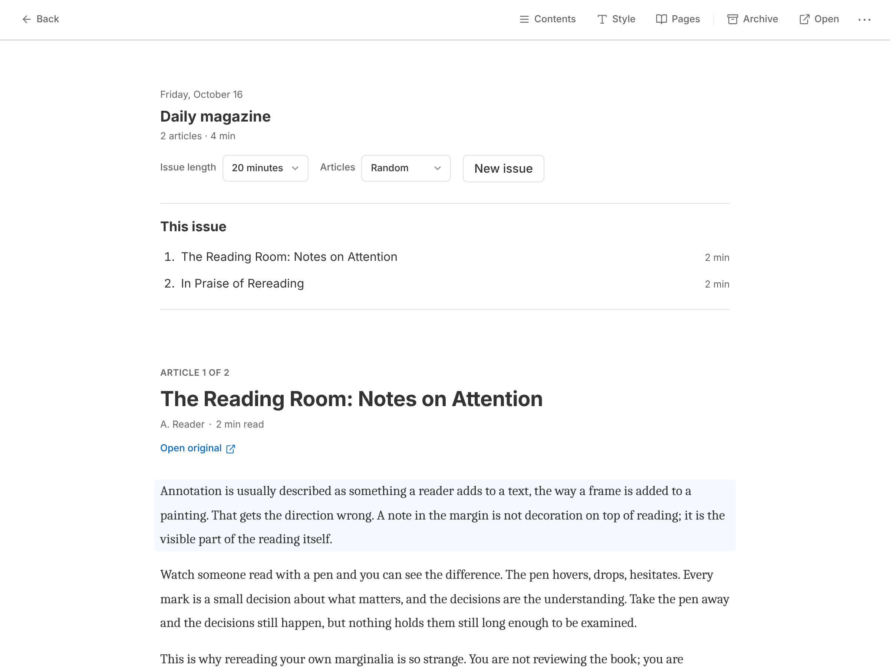

Skyreader gives you two ways into your reading. **Home** is a calm front page that picks up where you left off. **Feeds** is everything you follow, in one stream, with channels to slice it.

## Home

**Home** gathers what you're in the middle of: pick up where you left off, recent saves, a few things from your Shelf, your daily magazine. It draws on your [Library](/guide/your-library/), and each lane links to where it comes from.

**Continue reading** shows anything you've started and not finished, leaving out what you've archived. The Shelf's own Continue reading still includes a book you archived halfway through. **New connections** appears when someone on Semble connects something to one of your saves, as it does on the Shelf.

To change Home, choose **Customize** at the top of it. Pick where the app opens and how large the cards are, hide any section, or drag one by its handle to reorder. Changes apply right away and are saved on this device.

## Feeds

**Feeds** shows everything you follow in one chronological stream. The sidebar lists your sources, and your channels sit together under **Channels**. A **channel** is a saved view over what you read, your feeds, your saves or both, filtered by source or read state, so "Newsletters" or "Slow reads" is one click away.

### Choosing what shows

The **Sources** filter lists everything that brings you things to read, grouped:

- **From Bluesky**: **Your likes** and **Your bookmarks** (the links in posts you liked or bookmarked, if you've turned them on), and **People you follow** (the links they share).
- **Newsletters**: every sender, together or one by one.
- **Publications**: your feeds, by folder.

Everything starts checked. Uncheck a source, a folder or a whole group to leave it out. Choose **only** beside one to see just that. **Show everything** puts it all back. A group or folder stays whole as it grows: hide **Newsletters** and a newsletter that arrives tomorrow stays hidden too. On **Feeds**, the filter and the unread/all choice stay put when you come back or reload, on that device. Choose **Save** (on a phone, **Save as channel**) to keep a filter as a channel.

Items you scroll past can be marked read automatically (a toggle in **Settings → Reading**).

### Making a channel

Choose **New channel** under **Channels**, in the sidebar or the feed switcher on a phone.

- **Name** fills itself in from what you choose. Type your own to keep it.
- **Show** and **Order** set what the channel opens on: unread or everything, newest or oldest first.
- **What's in it**:
  - **Sources I pick**: a new channel starts with every source checked, your Library included; uncheck what it should leave out, or choose **Select none** and check the few you want. Check a folder to take in everything filed there, now and later. Under **From your Library**, **Your saves** takes in everything you've saved, and **Your Shelf** just what's on your Shelf. A save shows by when you saved it, marked **From your Library**, and opens in place like anything else in the channel, in **List** or **Expand**. One you've archived counts as read.
  - **Sources that match**: a rule picks them and keeps up as you follow more. **Daily Digest** takes sources that post several times a day, **Don't Miss** the ones that post rarely, and **Long Reads** the ones that write at length. You can also match the sources you added lately, ones you tagged, or ones from a site.
- **Which saves**: a channel of your saves alone, with nothing else checked, opens like your Queue, with **Inbox** and **Archive**. Narrow it by kind, when you saved it, length, site or tag, and order it by length or site too.

To change a channel later, open it and choose **Edit channel**, or right-click it in the sidebar. On a phone, **Edit channel** sits beside **View** in the view options.

### Arranging channels

To change the order of your channels, drag one up or down the sidebar. Or right-click it (on a phone, press and hold) and choose **Move up** or **Move down**. The order follows you to your other devices.

## The reader

Opening an article gives you a clean, full-screen reading surface.

Skyreader preserves the structure of Leaflet and Offprint publications, including galleries,
equations, buttons, task lists, and aligned text. If a publication uses an interactive widget the
reader cannot safely show, the article says so and links you to the original instead of silently
leaving content out. Members-only sections stay on their publication.

- **Font and size**: change the reading font and the text size from the reader's appearance controls.
- **Paged mode**: a toggle in the reader switches from scrolling to page turns, one page at a time, or two columns side by side on a wide screen. On a phone, swipe left for the next page and right to go back. If you'd rather swipe up and down, open **Style & Actions** (the sliders button at the right end of the bar at the bottom) and, under **Swipe to turn**, choose **Up & down**: swipe up for the next page, down to go back.
- **Contents**: an article with sections, a PDF or a book lists them under **Contents**: beside **Back** on a wide screen, in the bar at the bottom on a phone, or press **c**. The section you're in is marked; choose another to go there. A PDF or a book lists its own table of contents where it has one, in either view of a PDF.
- **Light and dark**: Skyreader follows your device's setting. To keep it light or dark regardless, pick a theme in **Settings → Reading → Appearance**.
- **Highlighting**: double-click a paragraph or select text. See [Saving and highlights](/guide/saving-and-highlights/).
- **Images**: click an image to see it full screen. Click again or press **Esc** to close it.

## Discussion

Articles carry a **Discussion** section at the end that gathers what people across the Atmosphere have written about that link: linkblog notes, Leaflet comments, Bluesky posts, Margin annotations, Semble connections, merged into one stream.

To add yours, use the buttons under **Add yours**. **Bluesky** writes a post from your own account, with the article's link card under your words; it's public like any Bluesky post.

To connect an article to another one on Semble, choose **Connect this to something** (or **Draw the first connection**), then pick how they relate. The other end can be any link: paste one, or search your library.

You don't have to go looking for the article you just finished. At the end of an article, above the Discussion, **Connect this to something you've read** shows your last few reads as cards. Tap one to connect the two, then pick how they relate. The same cards sit under the search field when you open the connect window. They show what you read on this device, plus saves you've read on any device.

To connect the article to a page it links to, tap the link and choose **Connect on Semble…**. Connections are public on Semble.

## The daily magazine

**Daily** builds a magazine issue from your saved articles. Pick an issue length in minutes and an ordering, then **Generate issue**. An issue is a snapshot: new saves don't reshuffle it, and it resumes where you left off on any device. When you finish, archive the issue or generate a new one from the current pile.

## Offline

Your feeds, saves, and highlights are stored on your device. Reading, marking read, highlighting, and the magazine all work offline; anything you do is queued and synced when you reconnect. Adding sources and changing sync settings need a connection.
