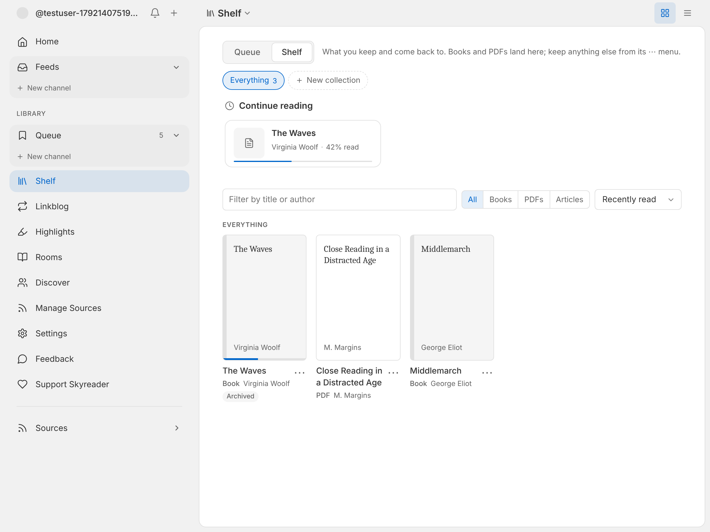

## Saving

Save an article from its card or from the reader, or from outside Skyreader entirely: the [Chrome extension](https://chromewebstore.google.com/detail/skyreader/kdefpnnpmajcclfepekgdkcdiklfooed), the bookmarklet, the iOS shortcut, or the Android share sheet (see [Adding sources](/guide/adding-sources/#save-and-subscribe-from-anywhere)). Saves keep the full article text, so they read fine offline. Everything you save lands in your [Library](#your-library-queue-and-shelf).

Saves are **private to Skyreader** by default. Nothing is published.

### What a save keeps

A save keeps the article as it was when you saved it, so it stays readable if the page is later edited or taken down. The end of a saved article says when it was captured and how: from the page in your browser (the extension), fetched by Skyreader, or from the feed. (Saves from before Skyreader kept captures don't show this.) Saving it again with new text, say from the extension, keeps the earlier capture too. Each capture carries a SHA-256 fingerprint of its text, so you can tell later whether two copies match. For [Supporters](/supporter/), each capture keeps the article's pictures too, so they still show after the site loses them.

When Skyreader couldn't get the text at all, the note in its place links to the Wayback Machine's copy of the page from around the day you saved it.

### Saving a link from inside an article

Tap a link in an article to see where it goes before you leave. From there you can open it, copy it, save it to Skyreader, or add it to a [Semble](https://semble.so) or [Margin](https://margin.at) collection. Semble and Margin collections are public.

### Filing into Semble and Margin collections

The collections you use most sit at the top of the picker. Star a collection to keep it there; the ones you used most recently join it. To find any other collection, type part of its name. Press Enter to add the top match, and ⌘ Enter (Ctrl Enter on Windows and Linux) to save.

If the article is already in Semble or Margin, the picker opens on the collections it's in, so you can move it rather than save it twice.

### Saving a PDF

PDFs are a [Supporter](/supporter/) feature. Save a link to a PDF (a paper, a report) the same way you save an article, or upload one from your device: open **+ → File**, or drop the file anywhere in Skyreader. Skyreader keeps its text, set as ordinary paragraphs, so you can read, highlight, take notes, and search it like anything else you save.

A saved PDF opens as text, set for reading. For figures, tables, equations, and layout, switch the toggle under the title from **Text** to **Original** to see the pages as printed. Highlight and take notes on either: a passage you mark in one is marked in the other. The PDF's own links work there too: a reference or a contents entry jumps to its page, and the arrow beside the page number takes you back. Skyreader remembers which you prefer and the zoom you left each PDF at, and Original opens where you stopped reading, on any of your devices. Whichever view you read in, a PDF you're partway through shows in **Continue reading**. In Original, the text-size keys zoom the pages: **Shift +** and **Shift -**, with **Shift 0** to fit the width. Skyreader keeps the original of every PDF you save, by link or upload, so it stays readable even if its site takes it down.

A scanned PDF has no text to keep, and a password-protected one can't be read. A very long PDF keeps the text of its first pages, and says so at the end.

Limits: a PDF can be up to 10 MB. You can upload 200 PDFs a month and keep up to 2 GB of PDF originals; removing a saved PDF frees its space. Up to 100 PDFs a day come through as text, by link or upload; past that, a saved link keeps just the link, and saving it again the next day brings in the text.

On the free plan, saving a link to a PDF keeps the link, so you can still open it from your Queue.

Uploaded PDFs are private to you. They stay on Skyreader, and aren't added to a Semble or Margin collection when your saves are backed by one.

### Saving an EPUB

EPUBs are a [Supporter](/supporter/) feature too. Save a link to an EPUB, or upload one: open **+ → File**, or drop the book anywhere in Skyreader. Skyreader keeps the book's text, chapter by chapter, so you can read, highlight, take notes, and search it like anything else you save. A book opens in pages; switch to scrolling and Skyreader remembers that for the book.

Skyreader keeps the words and pictures, not the publisher's design. A book opens on its cover, which also stands for it on your Shelf. The book's own links work: a footnote marker or a chapter's contents takes you to that place in the text. Skyreader keeps the original of every EPUB you save, by link or upload; its pictures are read from it. If your storage is full when you save a book by link, its text still comes through, but its pictures wait until there's room. A book with DRM can't be read. A very long book keeps its first chapters, and says so at the end.

Limits: an EPUB can be up to 30 MB. EPUBs share the PDF allowances: 200 uploads a month, and 2 GB of kept originals between them; removing a saved EPUB frees its space. Like uploaded PDFs, uploaded EPUBs are private to you and stay on Skyreader.

### Saving a YouTube video

Save a YouTube link and Skyreader keeps the video, its description, and its transcript when YouTube has one, so you can read, highlight, and search what was said. Each line of the transcript starts with its time: tap one and the video plays from there. While it plays, the line being spoken is marked, and the transcript keeps pace as long as you're reading along. Scroll away and it stays where you left it. The video stays at the top of the page while it plays, so you can watch and read together.

### When a site won't let Skyreader read it

Some sites refuse automated readers, or show them a bot check instead of the article, so Skyreader's servers can't fetch it even though it opens fine in your browser. The save still goes through: you get the link (titled with the article's title when Skyreader knows it, the address when it doesn't) with a note in place of the text. To get the full text, open the article and save it with the [Chrome](https://chromewebstore.google.com/detail/skyreader/kdefpnnpmajcclfepekgdkcdiklfooed) or [Firefox](https://addons.mozilla.org/firefox/addon/skyreader/) extension, which reads the page you already have open. That replaces the note.

Some pages load their text only once they're open in a browser, so Skyreader's servers find nothing to read. Those saves get the same note, and the extension gets the text the same way.

### Backing your saves with Semble or Margin

If you use [Semble](https://semble.so) or [Margin](https://margin.at), you can back your Library with one of them (**Settings → Library & privacy → Saved articles**). Your saves become a collection there: edit it in either app, or in any Atmospheric app, and the two stay in sync.

One thing to know before turning it on: **backing publishes your saves publicly**, because Semble and Margin collections are public. Saved newsletters and uploaded PDFs and EPUBs are the exception: they have no web link to share, so they stay private to Skyreader.

## Your Library: Queue and Shelf

Everything you save is in your **Library**, which you can read two ways. **Library** in the sidebar opens the Queue; switch between them with **Queue** and **Shelf** at the top of either.

- The **Queue** is what to read next, newest first. Read something, choose **Archive**, and it moves from the inbox to the archive.
- The **Shelf** is what you keep and come back to, like books, papers, and references. Finishing something doesn't take it off.

They're the same saves, so an item can be in both, and the two don't affect each other. Archiving clears an item from the Queue's inbox and leaves it on the Shelf, marked **Archived**. In the Queue, an item that's also on your Shelf is marked **On Shelf**. Each item's **⋯** menu shows both, side by side: **Archive** under Queue, **Add to Shelf** under Shelf.

Books and PDFs go on the Shelf as soon as you save them. To put anything else there, choose **Add to Shelf** from its **⋯** menu, or from the **⋯** menu while you're reading it. **Take off Shelf** removes it, and the save stays in your Queue.

The Shelf opens on **Continue reading**, the things you're partway through. Below that is everything on it, as covers or as a list. Filter by title or author, show only books, PDFs, or articles, and sort by what you read last, what you saved last, title, or author.

### Collections

Collections group what's on your Shelf, like a course's readings or a project's sources. Create one with **New collection**, then add items with **Add to collection**, from their **⋯** menu in the Queue or on the Shelf, or from the reader's **⋯** menu. An item can be in more than one collection. A collection keeps its own order (**Move up** and **Move down** in the item menu) and can carry a short description. Your collections are also listed under **Library** in the sidebar and the feed switcher, so you can open one from anywhere. To change their order, drag one up or down the sidebar. On a phone, press and hold one and choose **Move up** or **Move down**.

Collections are private to Skyreader and need an account and a connection.

## Highlights

While reading, double-click a paragraph or select text to highlight it. Drag the handles at either end to adjust what a highlight covers.

### Notes in the margin

Notes live beside the text, the way they would in a book. On a wide screen, every highlight gets a small bracket in the margin. Click the bracket (or choose **Note** after selecting text) and write right there, next to the passage. Your note saves when you click away or press Escape.

On a phone, or when reading in pages, there's no margin to write in. An asterisk after a passage means it has a note: tap it and the note unfolds under the paragraph.

Other readers' notes from Margin appear in the left margin, in pencil, when **Community highlights** is on.

Highlights are private to Skyreader and sync across your devices. Two optional Margin connections exist, in both directions:

- **Publish** puts a single highlight, and its note, on [Margin](https://margin.at), where anyone can see it. It's per-highlight and explicit; nothing is published unless you choose it.
- **Bring in highlights from Margin** (**Settings → Reading → Highlights**) adds your existing Margin highlights to your review deck here.
- **Community highlights** (**Settings → Reading → Highlights**) shows passages other readers highlighted on Margin while you read saved articles.

### Posting a highlight to Bluesky

Choose the Bluesky button on a highlight (in the reader, the **Highlights** page, or the review deck) to post it from your own account. In the reader, the button is there as soon as you select text, so you can post a passage without highlighting it first. The first time, Skyreader asks for permission to post for you.

The passage goes out as an image (a text shot): the quote set in the article's type, signed with the article's title and site, with the quote itself as the image's description. Your note becomes the post's text, which you can edit before posting; the article's link rides in the text. Switch **Quote as** to **Text** to quote the passage in the text instead, with the article's link card. Either way the post holds 300 characters; a ring appears as you near the limit.

Once posted, it's a public Bluesky post like any other: manage it in Bluesky.

## The review deck

The **Highlights** page collects every highlight, grouped by article. Its **Review** deck deals you a small handful at a time, so old highlights resurface instead of piling up. Each highlight carries a review intent: **soon**, **later**, **someday**, or **never** (kept, but out of rotation). A few keys drive the whole deck: arrow keys to move, `e` to edit the note, `o` to open the article.

## Exporting

**Settings → Library & privacy → Saved articles → Download a copy** gives you everything you've saved and highlighted as one file, on any plan:

- **Markdown**, for notes apps like Obsidian: each save, with its link, its highlights as quotes, and your notes under them. Pages you highlighted without saving come after your saves.
- **BibTeX**, for reference managers like Zotero and for LaTeX: one entry per save, with your highlights and notes in its `annote` field.

When a save is a paper, the export carries its DOI and arXiv id. Skyreader reads the DOI from the page's own citation details when you save it, and both from the link (doi.org, arXiv, bioRxiv, and publisher `/doi/` pages) and, for a saved PDF, from its first page.

## Limits

The free plan includes 100 URL saves a month (saving from the web, your phone, or the extension); Supporters get 1,000. See [Supporter](/supporter/).
