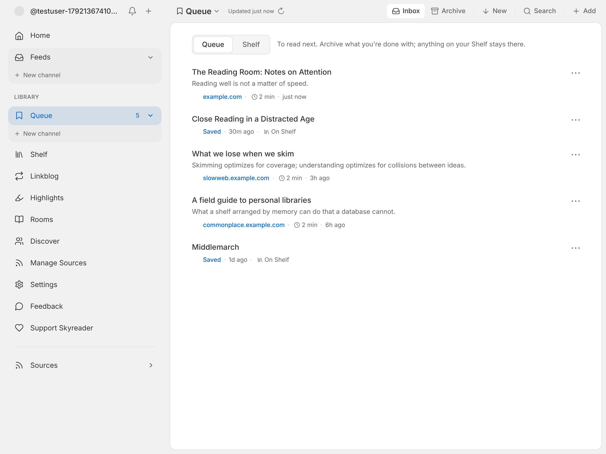
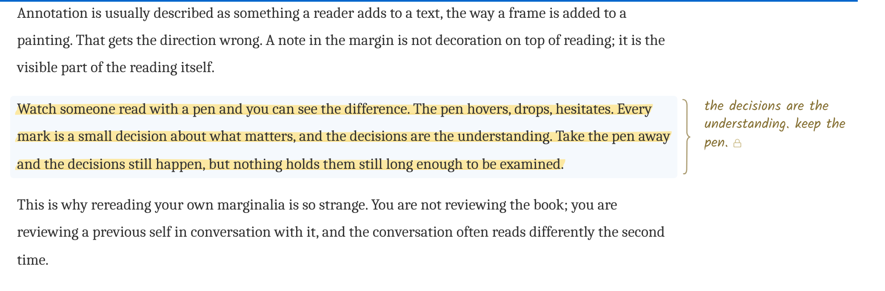
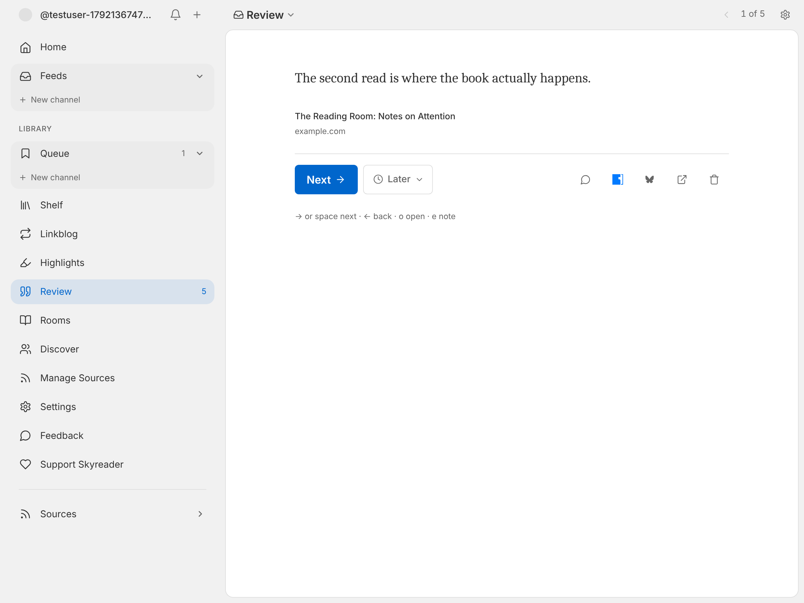

Saving keeps an article, with its full text, in your [Library](/guide/your-library/) to read later. Highlighting marks the passages that matter, and a note in the margin says why. Both are private to you unless you choose to publish something.

## Saving

Choose **Save** on an article's card or in the reader. To save a page you found outside Skyreader, use the [Chrome](https://chromewebstore.google.com/detail/skyreader/kdefpnnpmajcclfepekgdkcdiklfooed) or [Firefox](https://addons.mozilla.org/firefox/addon/skyreader/) extension, the bookmarklet, the iOS shortcut, or the Android share sheet (see [Save and subscribe from anywhere](/guide/adding-sources/#save-and-subscribe-from-anywhere)). Or paste a link into the **+** button's **Link** tab.

Everything you save lands in your Library, at the top of your **Queue**. Saves keep the full article text, so they read fine offline.

Saves are **private to Skyreader** by default. Nothing is published unless you [back your saves with Semble or Margin](#backing-your-saves-with-semble-or-margin).

### Saving from the reader

In the reader, **Save** puts the article in your Library and opens a small panel beside the button. If you want to come back to it, tick **Shelf**, or tick one of your [collections](/guide/your-library/#collections) (that puts it on the Shelf too). You can start a new collection there as well. Or skip all that and keep reading: click anywhere else, scroll, or press Escape. On a phone, the panel opens above the bar at the bottom of the screen.

Once an article is saved, the button reads **Saved**, or **On Shelf**, and pressing it opens the same panel. If you opened the article from a feed, **Remove** in the panel takes it back out of your Library, and the **s** key saves or unsaves without opening the panel. To delete something you opened from your Library, use **Delete** in the reader's **⋯** menu.

### When a site won't let Skyreader read it

Some sites refuse automated readers, or show them a bot check instead of the article, so Skyreader's servers can't fetch it even though it opens fine in your browser. The save still goes through: you get the link (titled with the article's title when Skyreader knows it, the address when it doesn't) with a note in place of the text. To get the full text, open the article and save it with the [Chrome](https://chromewebstore.google.com/detail/skyreader/kdefpnnpmajcclfepekgdkcdiklfooed) or [Firefox](https://addons.mozilla.org/firefox/addon/skyreader/) extension, which reads the page you already have open. That replaces the note.

Some pages load their text only once they're open in a browser, so Skyreader's servers find nothing to read. Those saves get the same note, and the extension gets the text the same way.

### What a save keeps

A save keeps the article as it was when you saved it, so it stays readable if the page is later edited or taken down. The end of a saved article says when it was captured and how: from the page in your browser (the extension), fetched by Skyreader, or from the feed. (Saves from before Skyreader kept captures don't show this.) Saving it again with new text, say from the extension, keeps the earlier capture too. Each capture carries a SHA-256 fingerprint of its text, so you can tell later whether two copies match. For [Supporters](/supporter/), each capture keeps the article's pictures too, so they still show after the site loses them.

When Skyreader couldn't get the text at all, the note in its place links to the Wayback Machine's copy of the page from around the day you saved it.

### Editing a save's details

When a save's title or author came through wrong, or a PDF arrived as "untitled", fix it: choose **Edit details** from its **⋯** menu, in your Queue, on the Shelf, or while you're reading it. You can change the title, the author (separate several with a semicolon), the date it was published, and the summary. Your changes show everywhere the save does, including search and exports, and saving the page again later keeps them. They stay in Skyreader: a save backed by Semble or Margin keeps the card as it was there.

### PDFs, books, and videos

You can also save PDFs and EPUBs (with the [Supporter plan](/supporter/)) and YouTube videos with their transcripts. They have their own page: [PDFs, books, and videos](/guide/pdfs-books-and-videos/).

### Saving a link from inside an article

Tap a link in an article to see where it goes before you leave. From there you can open it, copy it, save it to Skyreader, or add it to a [Semble](https://semble.so) or [Margin](https://margin.at) collection. Semble and Margin collections are public.

### Filing into Semble and Margin collections

The collections you use most sit at the top of the picker. Star a collection to keep it there; the ones you used most recently join it. To find any other collection, type part of its name. Press Enter to add the top match, and ⌘ Enter (Ctrl Enter on Windows and Linux) to save.

If the article is already in Semble or Margin, the picker opens on the collections it's in, so you can move it rather than save it twice.

### Backing your saves with Semble or Margin

If you use [Semble](https://semble.so) or [Margin](https://margin.at), you can back your Library with one of them. The line under the Queue | Shelf switch in your Queue says where your saves live; choose **Link to Semble or Margin** there (or go to **Settings → Library & privacy → Saved articles**). Your saves become a collection there: edit it in either app, or in any Atmospheric app, and the two stay in sync. Once it's on, the same line names the collection and when it last synced, and **Change** switches or turns it off. Turning it on can also copy the saves you already have into the collection. That copy runs in the background, at the pace your account allows ([why a big one takes a while](/guide/importing-your-library/#a-large-import-takes-a-while-to-copy)).

One thing to know before turning it on: **backing publishes your saves publicly**, because Semble and Margin collections are public. Saved newsletters and uploaded PDFs and EPUBs are the exception: they have no web link to share, so they stay private to Skyreader.

Where your saves go from here, the Queue, the Shelf and collections, is on [Your Library](/guide/your-library/).

## Highlights

While reading, double-click a paragraph or select text to highlight it. Drag the handles at either end to adjust what a highlight covers.

### Notes in the margin

Notes live beside the text, the way they would in a book. On a wide screen, every highlight gets a small bracket in the margin. Click the bracket (or choose **Note** after selecting text) and write right there, next to the passage. Your note saves when you click away or press Escape.

On a phone, or when reading in pages, there's no margin to write in. An asterisk after a passage means it has a note: tap it and the note unfolds under the paragraph.

Other readers' notes from Margin appear in the left margin, in pencil, when **Community highlights** is on.

Highlights are private to Skyreader and sync across your devices. Two optional Margin connections exist, in both directions:

- **Publish** puts a single highlight, and its note, on [Margin](https://margin.at), where anyone can see it. It's per-highlight and explicit; nothing is published unless you choose it.
- **Sync with Margin** (at the top of the **Highlights** page, or **Settings → Reading → Highlights**) adds your Margin highlights to Skyreader and keeps them in step. The same line says when it last synced, and Skyreader tells you when a sync removes a highlight. New highlights you make in Margin show up here, and editing or deleting one in Margin does the same here. A highlight deleted in Margin goes from Skyreader too, along with any tags or pin you gave it here. Deleting one you published from Skyreader only unpublishes it: it stays in Skyreader, private. If you edit a note in both places before they catch up, your Skyreader edit is kept. With a very large Margin library (thousands of highlights), deletions wait until Skyreader can read all of it. Changes from Margin come in when you open or return to Skyreader, checked at most every 15 minutes.
- **Community highlights** (**Settings → Reading → Highlights**) shows passages other readers highlighted on Margin while you read saved articles.

### Posting a highlight to Bluesky

Choose **Post to Bluesky** on a highlight (in the reader, the **⋯** menu on the **Highlights** page, or the review deck) to post it from your own account. In the reader, the button is there as soon as you select text, so you can post a passage without highlighting it first. The first time, Skyreader asks for permission to post for you.

The passage goes out as an image (a text shot): the quote set in the article's type, signed with the article's title and site, with the quote itself as the image's description. Your note becomes the post's text, which you can edit before posting; the article's link rides in the text, and #hashtags and @mentions in it work as they do on Bluesky. Switch **Quote as** to **Text** to quote the passage in the text instead, with the article's link card. Either way the post holds 300 characters; a ring appears as you near the limit.

Once posted, it's a public Bluesky post like any other: manage it in Bluesky.

### Connecting from a passage

Choose **Connect on Semble** on a selection or a highlight in the reader to connect the article to another one on Semble. The passage is quoted at the start of the connection's note, followed by your highlight's note if it has one, so the connection says why. Like posting, connecting from a selection doesn't also highlight it. Connections are public on Semble.

## The Highlights page

The **Highlights** page keeps every highlight in one place to manage. Search them, or narrow the list to **Pinned**, **With notes**, **On Margin**, a tag, or one source (on a phone, choose **Only this source** from a highlight's **⋯** menu). Sort by newest, oldest, or by source.

- **Pin** the few that matter and they stay on a shelf at the top.
- **Tag** a highlight to gather passages across articles. Tags are yours alone, on the highlight, and the picker suggests the tags you already use.
- **Publish to Margin** makes a highlight public on Margin; on a pinned card it's in the **⋯** menu.
- The **⋯** menu on each highlight narrows to its source, posts it to Bluesky, takes it out of review, or removes it.

## The review deck

The **Highlights** page's **Review** deck deals you a small handful at a time, so old highlights resurface instead of piling up. Each highlight carries a review intent: **soon**, **later**, **someday**, or **never** (kept, but out of rotation). A few keys drive the whole deck: arrow keys to move, `e` to edit the note, `o` to open the article.

## Exporting

**Settings → Library & privacy → Saved articles → Download a copy** gives you everything you've saved and highlighted as one file, on any plan:

- **Markdown**, for notes apps like Obsidian: each save, with its link, its highlights as quotes, and your notes under them. Pages you highlighted without saving come after your saves.
- **BibTeX**, for reference managers like Zotero and for LaTeX: one entry per save, with your highlights and notes in its `annote` field.

When a save is a paper, the export carries its DOI and arXiv id. Skyreader reads the DOI from the page's own citation details when you save it, and both from the link (doi.org, arXiv, bioRxiv, and publisher `/doi/` pages) and, for a saved PDF, from its first page.

To keep a notes app up to date as you go, rather than downloading once, see [Notes and reference managers](/guide/notes-and-reference-managers/).

## Limits

The free plan includes 100 URL saves a month (saving from the web, your phone, or the extension); Supporters get 1,000. See [Supporter](/supporter/).
