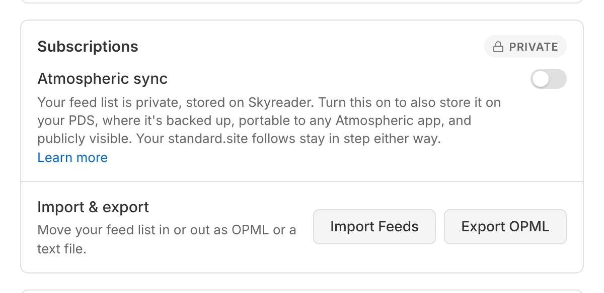

The short version: **your reading is private to you by default.** A few things are public, or can be made public, so they're portable across the Atmosphere.

Most of the public things live in your **PDS**: the part of your Atmosphere account that holds what you publish, readable by anyone and by any Atmospheric app. Saves are different: Skyreader doesn't store them on your PDS. Backing them with Semble or Margin publishes them as a public collection in that app. Everything else stays on Skyreader's servers and your devices, private to you.

## At a glance

| What                      | Where it lives                                 | Visibility                                      |
| ------------------------- | ---------------------------------------------- | ----------------------------------------------- |
| Read state                | Skyreader's servers + your devices             | Private                                         |
| Subscriptions             | Skyreader's servers (+ your PDS if you opt in) | Private; public if Atmospheric sync is on       |
| Saved articles            | Skyreader's servers + your devices             | Private; public if backed by Semble or Margin   |
| Uploaded PDFs and EPUBs   | Skyreader's servers                            | Private, even when your saves are backed        |
| Newsletters               | Skyreader's servers                            | Private                                         |
| Search and saved searches | Skyreader's servers                            | Private                                         |
| Highlights and notes      | Skyreader's servers + your devices             | Private; a highlight you publish is public      |
| Shared links (linkblog)   | Your PDS                                       | Always public                                   |
| Recommends                | Your PDS                                       | Always public                                   |
| Reading rooms             | Your PDS (joins); Skyreader's servers (reads)  | Joining is public; reads are an anonymous count |
| Links from your follows   | Skyreader's servers, for a week                | Private                                         |
| Bluesky likes/bookmarks   | Skyreader's servers (the links in them)        | Private                                         |
| Guest data                | Your device only                               | Private                                         |

## Subscriptions and Atmospheric sync

Your feed list is private, stored on Skyreader. Turning on **Atmospheric sync** (**Settings → Library & privacy → Subscriptions**) also stores it on your PDS, where it's backed up, portable to any Atmospheric app, and **publicly visible**. That last part is the tradeoff to weigh: sync makes your subscription list something anyone can look up.

Sync covers subscriptions. It does not touch your saves, highlights, or read state.

### Private feeds

Some feeds are meant for you alone: a member-only podcast from Patreon or Supercast, or a feed whose link carries a personal key. Anyone who has that link can read the feed as you, so publishing the link gives the access away.

When Atmospheric sync is on and you add a feed whose link looks like this, Skyreader asks first. **Keep it private** subscribes you and leaves that one feed off your PDS. It stays on Skyreader's servers, works on all your devices, and the rest of your list syncs as usual. **Sync it publicly** treats it like any other feed.

Skyreader judges from the link alone, so it can miss one. If a private link does reach your PDS, unsubscribing removes it from there.

Either way, you can walk away with your list at any time: **Settings → Library & privacy → Export OPML**.

## Saved articles

Saves live on Skyreader, private to you. They are **not** stored on your PDS. The copy of each article captured when you saved it stays with the save, just as private, and is deleted when you remove the save.

The one way a save becomes public is choosing it: backing your Library with **Semble or Margin** (**Settings → Library & privacy → Saved articles**) turns the list into a public collection in that app. Saved newsletters and uploaded PDFs and EPUBs stay private either way.

## Highlights and notes

Highlights are private to Skyreader and sync across your devices through Skyreader, not through your PDS.

If you'd like to share a highlight publicly, you can share an individual highlight to **Margin**, which publishes that one highlight to your public PDS.

You can take your saves, highlights, and notes with you at any time, as Markdown or BibTeX: see [Exporting](/guide/saving-and-highlights/#exporting).

## Your linkblog

Shared links are always public. That's their point: a linkblog is a publication in your PDS, readable across the Atmosphere, with a public page and RSS feed. See [Sharing](/guide/sharing-and-your-linkblog/).

## Recommends

Recommending an article writes a public record to your PDS, so anyone can see what you've recommended. Take a recommend back and the record is deleted. See [Recommending](/guide/sharing-and-your-linkblog/#recommending).

## Reading rooms

Joining a room writes a public record to your PDS, so anyone can see you're reading along. What you read in a room shows up only as an anonymous count, stored on Skyreader. See [Reading rooms](/guide/reading-rooms/).

## Links from your follows

If you turn on [From your follows](/guide/from-your-follows/), Skyreader reads your Bluesky Following timeline and keeps the links it finds for a week, privately. Reading your follows never posts anything; Skyreader posts to Bluesky only when you tick **Also on Bluesky** on a share, post a highlight there, or post from an article's **Discussion**.

## Your Bluesky likes and bookmarks

If you add [your Bluesky likes or bookmarks](/guide/adding-sources/#your-bluesky-likes-and-bookmarks) as a source, Skyreader reads them and keeps the posts that link somewhere as articles, privately. Removing the source deletes them. Reading your bookmarks needs your permission, because they're private on Bluesky; your likes are already public there.

## Seeing for yourself

The Atmosphere is inspectable. **Settings → Library & privacy** links to a viewer showing everything in your public PDS data, so you can verify what's there rather than take this page's word for it.

## Guests

Guest reading stores everything on your device. Nothing leaves it until you sign in, at which point your saves, highlights, and read state migrate to your account.

## Taking it with you, or deleting it

- **Subscriptions:** **Settings → Library & privacy → Export OPML**.
- **Saves, highlights, and notes:** **Download a copy**, as Markdown or BibTeX. See [Exporting](/guide/saving-and-highlights/#exporting).
- **Your linkblog:** **Settings → Linkblog → Delete linkblog** removes every link post from your PDS.
- **Your account:** email [privacy@skyreader.app](mailto:privacy@skyreader.app) to ask for a copy of what Skyreader holds about you, or to delete it. Deleting your account removes your data from Skyreader's servers. What you put on your PDS stays there, under your control, and anything in Semble or Margin stays with that app.
